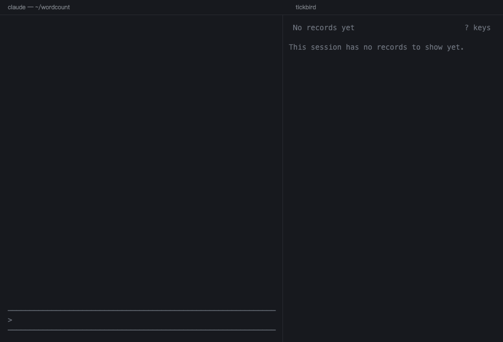
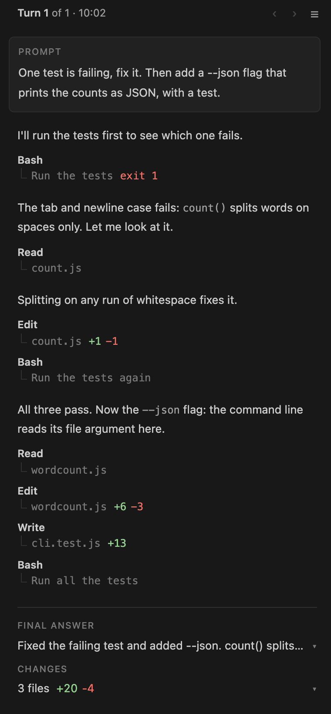

# Tickbird

**在 Agent 旁边，一步一步看它在做什么。**

[English](./README.md) · 中文



Tickbird 读取 Claude Code 和 Codex 写在本机的会话记录，把每一轮整理成一页：你问了什么，Agent 说了什么、跑了哪些命令、改了哪些文件，最后怎么答的。它只读：不给 Agent 发消息，也不执行记录里的命令。

- **两个版本**：终端里在 Agent 旁边开一栏；VS Code 里在侧边栏。
- **实时**：新内容随 Agent 干活出现；Agent 停下等你批准时会提示。
- **点开看证据**：读过的文件选中那几行，改动打开 diff，命令看输出。

界面跟随系统语言，中文系统下显示中文；也可以手动指定，见使用说明的 [Language](./docs/USAGE.md#language) 一节。

## 两个版本

| 终端版 | VS Code 版 |
| --- | --- |
| 在 kitty、tmux 等终端里，Agent 旁边自动开一栏，见上面的动图。 | 在左侧主侧栏，详情开在编辑器区。 |
| |  |

## 安装

需要 Node.js 22 以上，以及 Claude Code 或 Codex。

### 终端版

在 Claude Code 里：

```
/plugin install tickbird-split --marketplace zchan0/tickbird
```

在 Codex 里：

```sh
codex plugin marketplace add zchan0/tickbird
codex plugin add tickbird-state@tickbird
codex plugin add tickbird-split@tickbird
```

之后新开的 Agent 会话旁边会自动开一栏。kitty 要先打开远程控制：在 Claude Code 里运行 `/tickbird-split:kitty`。其它终端的情况见[终端支持](./docs/TERMINALS.md)。

### VS Code 版

从 [Releases](https://github.com/zchan0/tickbird/releases) 下载 `tickbird-<版本>.vsix`，然后：

```sh
code --install-extension tickbird-<版本>.vsix
```

再给 Agent 装上 `tickbird-state` 插件（装了终端版就已经有了）：在 Claude Code 里运行 `/plugin install tickbird-state --marketplace zchan0/tickbird`。有了它，侧栏会跟随本窗口的会话，并在 Agent 等你批准时提示。

## 文档

以下文档是英文的：

- [使用说明](./docs/USAGE.md)：按键、点开调用看到什么、实时和跟随，以及安装时可能遇到的情况。
- [终端支持](./docs/TERMINALS.md)：各终端能不能自动开栏。
- [开发](./docs/DEVELOPMENT.md)：从源码构建、测试、发版。
- [更新记录（Changelog）](./CHANGELOG.md)

## 许可

[MIT](./LICENSE)
